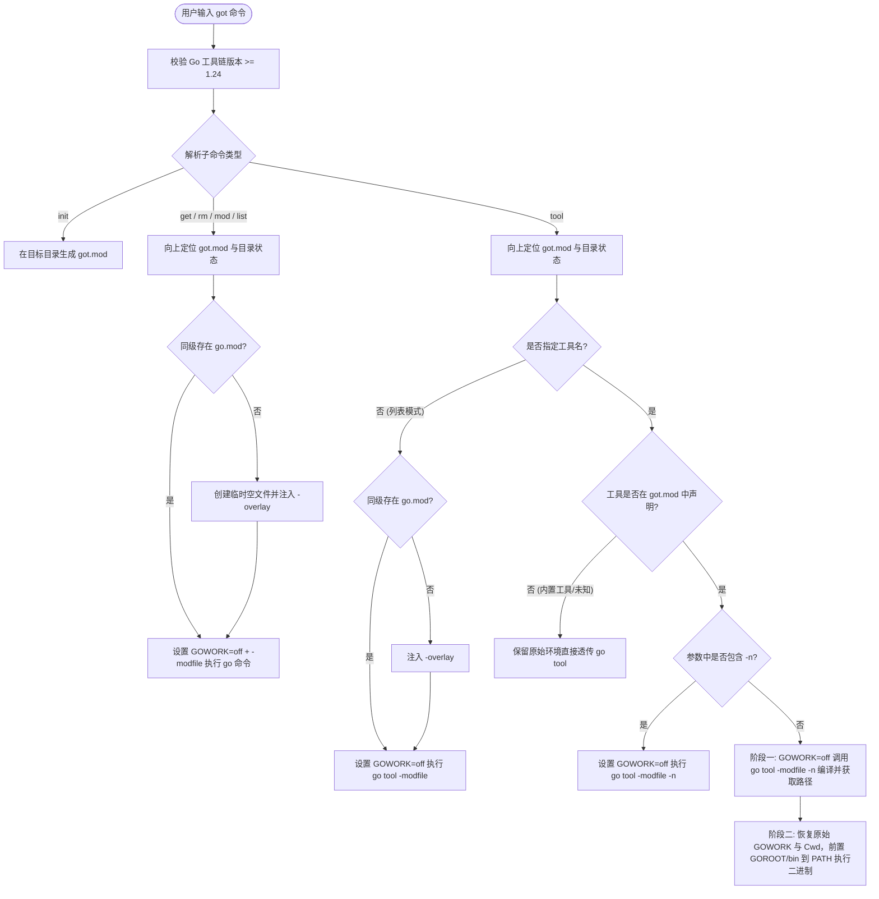

# `got` 技术方案实现文档

## 1. 背景与目标

### 1.1 背景痛点
自 Go 1.24 起，官方引入了 `go.mod` 中的 `tool` 指令以及 `go get -tool`、`go tool` 原生命令，用于管理项目开发期依赖工具（如 `golangci-lint`、`stringer`、`mockgen`、`sqlc` 等）。但在实际工程实践中，直接将工具声明在主项目 `go.mod` 中存在以下显著问题：

1. **依赖图膨胀**：单个开发工具往往引入数十至上百个间接依赖，写入主项目 `go.mod` 与 `go.sum` 后，会混入大量与业务运行时无关的依赖条目。
2. **MVS 版本耦合**：当主项目代码与工具依赖了相同的三方库时，Go 的最小版本选择（MVS）机制可能导致工具依赖拉高主项目实际使用的包版本。
3. **升级互相干扰**：执行 `go get -u` 更新业务依赖时可能连带变动工具依赖，反之亦然，增加代码评审与回归测试的成本。

### 1.2 设计目标
设计并实现独立的 Go 工具链依赖管理与执行器 `got`，配套独立清单文件 `got.mod` 与校验文件 `got.sum`：

* **完全隔离**：工具依赖与校验和仅记录在 `got.mod` / `got.sum` 中，不修改、不污染主项目的 `go.mod` / `go.sum`。
* **原生对齐**：CLI 交互风格（`got get -tool`、`got tool`、`got mod tidy` 等）与 Go 原生命令保持高度一致，零额外学习成本。
* **复用生态**：100% 复用 Go 原生构建缓存（`GOCACHE`）、模块缓存（`GOMODCACHE`）、校验和数据库（`GOSUMDB`）及 MVS 解析能力。
* **环境兼容**：完整兼容普通单模块项目、`go.work` 多模块工作区（Workspace）以及无 `go.mod` 的纯工具/非 Go 仓库。
* **轻量零依赖**：`got` 自身仅使用 Go 标准库实现，编译为单一静态二进制，无需引入第三方库。

---

## 2. 技术选型与核心原理

### 2.1 核心方案：根目录 `got.mod` + `-modfile` 驱动

经过对比子目录 `.got/go.mod` 与独立二进制管理器等方案，最终确定采用 **“根目录 `got.mod`/`got.sum` + Go 原生 `-modfile` 机制”**（方案 A）：

* **文件约定**：`got.mod` 与项目 `go.mod` 同级存放，底层透传 `-modfile=/abs/path/to/got.mod` 给 `go` 工具链。Go 原生约定会将 `-modfile` 路径中的 `.mod` 后缀替换为 `.sum`，从而自动读写同级 `got.sum`。
* **主项目零干扰**：主项目运行 `go build`、`go test`、`go mod tidy` 时会完全忽略 `got.mod` 和 `got.sum`。

### 2.2 已验证的关键技术难点与解法

基于 `go1.27.4` 实际验证，直接简单包装 `go <cmd> -modfile=got.mod` 存在多处深层陷阱，本方案针对以下难点制定了明确的工程解法：

#### 难点 1：`go.work`（Workspace 模式）冲突与子进程环境污染
* **问题现象**：当项目或上级目录存在 `go.work` 时，执行 `go get -modfile=...` 或 `go tool -modfile=...` 会报错：`go: -modfile cannot be used in workspace mode`。若粗暴全局设置 `GOWORK=off` 来启动工具，子进程（如 `golangci-lint`、`mockgen`、`wire`）会继承 `GOWORK=off`，导致分析主项目代码时丢失多模块工作区上下文。
* **解法（编译与执行两阶段解耦）**：
  1. **阶段一（解析与编译）**：设置 `GOWORK=off` 调用 `go tool -modfile=/abs/path/got.mod -n <tool>`。`go tool -n` 会真实触发按需增量编译并将可执行文件写入 `GOCACHE`，随后仅打印该二进制文件的绝对路径。
  2. **阶段二（独立执行）**：恢复用户**原始 `GOWORK`、原始环境变量和当前工作目录 `Cwd`**，在 `PATH` 最前方插入 `$GOROOT/bin`（对齐原生 `go tool` 规范），直接执行阶段一获取的二进制文件并转发信号与退出码。

#### 难点 2：无 `go.mod` 目录无法确定模块根目录
* **问题现象**：Go 工具链要求 `-modfile` 所在目录必须同时存在 `go.mod` 以定位 module root，否则报错：`cannot find main module, but -modfile was set.`（常见于纯 `go.work` 根目录或非 Go 项目仓库）。
* **解法（动态 `-overlay` 虚拟占位）**：
  * 当检测到 `got.mod` 同级不存在 `go.mod` 时，在系统临时目录创建空文件 `empty.mod` 与映射文件 `overlay.json`：
    ```json
    {"Replace": {"<gotRoot>/go.mod": "<tmpDir>/empty.mod"}}
    ```
  * 在调用 `go get`、`go mod`、`go tool`、`go list` 时附带 `-overlay=<tmpDir>/overlay.json`。进程退出前自动清理临时目录，不在项目内产生任何残留文件。

#### 难点 3：Go 内置工具与 `got.mod` 工具分流
* **问题现象**：`go tool vet`、`go tool pprof`、`go tool trace` 等属于 Go SDK 内置工具（位于 `$GOROOT/pkg/tool/...`），不应强行受限于 `got.mod`。
* **解法**：执行 `got tool <name>` 时，先解析 `got.mod` 中声明的 `tool` 列表。若匹配成功（全路径匹配或唯一末段短名匹配），走两阶段编译执行；若未声明且属于 Go 内置工具，则直接以原始环境透传给 `go tool <args...>`。

#### 难点 4：`//go:generate` 子目录工作区定位
* **问题现象**：在子包目录执行 `//go:generate got tool stringer -type=MyEnum` 时，命令的 `Cwd` 是子包目录，而非仓库根目录。
* **解法**：从当前工作目录向上逐级查找 `got.mod`（支持 `-C` 与 `GOTFILE` 覆盖），传递给 `-modfile` 时始终使用 `got.mod` 的绝对路径，同时**保持阶段二执行二进制文件时的 `Cwd` 为用户原始工作目录不变**。

#### 难点 5：`GOFLAGS` 环境变量冲突
* **问题现象**：若全局设置了 `GOFLAGS="-mod=vendor"` 或 `"-mod=readonly"`，会导致 `got get` 或 `got tool` 尝试去主项目 `vendor/` 查找工具源码而失败。
* **解法**：在 `runner` 封装底层 `go` 调用环境时，解析 `GOFLAGS` 并剥离其中的 `-mod=...` 标记，必要时显式指定适合当前子命令的 `-mod` 策略。

---

## 3. 整体架构设计

### 3.1 执行流程图



### 3.2 代码工程结构

```text
/home/yougg/code/got/
├── go.mod                          # 仅依赖 Go 标准库 (go 1.24+)
├── DESIGN.md                       # 本技术方案实现文档
├── cmd/
│   └── got/
│       └── main.go                 # CLI 入口、全局标志解析、日志初始化、退出码映射
└── internal/
    ├── cli/
    │   └── app.go                  # 子命令路由分发 (init/get/rm/tool/mod/list/version)
    ├── gomod/
    │   ├── version.go              # Go 版本检查 (>= 1.24) 与 GOROOT 信息获取
    │   └── modfile.go              # 封装 go mod edit -json 解析 tool 声明及包名匹配
    ├── locator/
    │   └── locator.go              # 向上查找 got.mod、支持 -C / GOTFILE、检测 go.mod 共存状态
    ├── runner/
    │   ├── runner.go               # 底层 go 命令构造器 (GOWORK=off, -modfile, GOFLAGS 清理)
    │   └── overlay.go              # 临时 -overlay 生成与自动销毁生命周期管理
    └── executor/
        └── executor.go             # 两阶段编译执行器、PATH 注入、信号转发与退出码透传
```

---

## 4. CLI 命令规范设计

### 4.1 全局参数与环境变量

* **`-C <dir>`**：在执行命令前切换工作目录（与原生 `go -C` 语义一致，优先于当前目录查找）。
* **`GOTFILE=<path>`**：显式指定 `got.mod` 文件路径，跳过向上目录查找。
* **`GOT_DEBUG=1`**：开启调试日志，通过 `log/slog` 向 `stderr` 输出实际执行的底层 `go` 命令、环境变量覆写及 `-overlay` 状态。

### 4.2 子命令明细

| 命令 | 语法示例 | 底层映射与处理逻辑 |
| :--- | :--- | :--- |
| **`got init`** | `got init [module-path]`<br>`got init --same-module` | 1. 若当前目录已存在 `got.mod` 则报错退出。<br>2. 默认生成 `module got.local/tools` 与当前 Go 版本号（`go X.Y`）。<br>3. 指定 `--same-module` 时读取同级 `go.mod` 的模块路径写入 `got.mod`，用于支持调用仓库本地 `cmd/` 下的内部工具。<br>4. 若同级 `go.mod` 中已声明 `tool` 列表，自动复制到 `got.mod` 并按对应版本拉取依赖包完成初始化（包含本地工具时自动复用主模块路径）。 |
| **`got get`** | `got get -tool pkg@v1.2.3`<br>`got get -u`<br>`got get -u pkg` | 1. 透传参数至 `go get -modfile=<got.mod> ...`。<br>2. 若使用 `got get -u` 且未传包参数，自动补充 `tool` 元包模式（即 `go get -modfile=<got.mod> -u tool`），防止更新范围异常。<br>3. 若当前尚未初始化 `got.mod` 且执行 `got get -tool`，可报错提示执行 `got init`（或通过 `--init` 自动初始化）。 |
| **`got rm`**<br>(`remove`) | `got rm <tool-or-pkg>...` | 1. 支持传入短名（自动从 `got.mod` 解析对应全路径）或完整包路径。<br>2. 依次执行 `go get -modfile=<got.mod> -tool <pkg>@none` 与 `go mod tidy -modfile=<got.mod>`，一步完成移除与清理。 |
| **`got tool`**<br>(`exe`) | `got tool`<br>`got tool [-n] <name> [args...]`<br>`got exe <name> [args...]` | 1. **无参数**：调用 `go tool -modfile=<got.mod>` 展示可用工具列表。<br>2. **匹配 `got.mod` 自定义工具**：<br>   - 带 `-n`：直接打印 `go tool -modfile=<got.mod> -n <target>` 的结果。<br>   - 正常执行：走“两阶段编译 + 执行”引擎，透传 `<args...>`、stdin/stdout/stderr 与系统信号。<br>3. **未匹配 `got.mod`**：视作 Go 内置工具，剥离 `-modfile` 并以用户原始环境透传 `go tool <args...>`。 |
| **`got mod`** | `got mod tidy`<br>`got mod download`<br>`got mod verify`<br>`got mod edit ...` | 在子命令后插入 `-modfile=<got.mod>`（注意：`go mod` 要求 `-modfile` 位于子命令如 `tidy`/`edit` 之后，例如 `go mod tidy -modfile=...`）。 |
| **`got list`** | `got list tool`<br>`got list -m all` | 映射为 `go list -modfile=<got.mod> ...`。 |
| **`got version`** | `got version` | 输出 `got` 自身版本、构建信息以及底层 `go env GOVERSION`。 |

> [!IMPORTANT]
> **参数位置细节**：Go CLI 中 `-modfile` 属于构建/模块通用标志，放在 `go get`、`go tool`、`go list` 后面即可，但在 `go mod <subcmd>` 中**必须放在 `<subcmd>` 之后**（如 `go mod tidy -modfile=got.mod`，不能写成 `go mod -modfile=got.mod tidy`）。`runner` 模块须按子命令精确拼接参数位置。

---

## 5. 核心模块实现设计

所有 Go 代码遵循项目规范：错误判断使用 `errors.Is`、日志使用 `log/slog`、泛型/任意类型使用 `any`、集合操作优先使用 `slices`/`maps`、禁止零长度切片字面量初始化。

### 5.1 `internal/gomod`：版本检查与工具解析

1. **Go 版本检查**：
   * 执行 `go env -json GOVERSION GOROOT` 获取当前 Go 环境信息。
   * 解析 `GOVERSION`（形如 `go1.24.0`、`go1.27.4`、`devel go1.25-...`），提取主版本号和次版本号，确认满足 `major > 1 || (major == 1 && minor >= 24)`；不满足则返回清晰错误提示。
2. **`got.mod` 工具列表解析**：
   * 不引入外部 AST 库，直接调用 `go mod edit -modfile=<got.mod> -json` 反序列化标准输出：

```go
package gomod

// ModEditJSON 对应 go mod edit -json 的输出结构
type ModEditJSON struct {
	Module struct {
		Path string `json:"Path"`
	} `json:"Module"`
	Go   string     `json:"Go"`
	Tool []ToolItem `json:"Tool"`
}

// ToolItem 表示 got.mod 中声明的单条 tool 指令
type ToolItem struct {
	Path string `json:"Path"`
}
```

3. **工具名称匹配规则（对齐原生 `go tool`）**：
   * 提取每个 `ToolItem.Path` 的默认二进制短名：取路径最后一段，若最后一段形如主版本后缀 `vN`（例如 `example.com/tool/v2`），按 Go 官方规范剥离 `/v2` 后取前一段（或使用 `go tool` 的命名推导规则，更稳妥的方式是直接结合 `path.Base` 规则校验歧义）。
   * 若用户传入的 `<name>` 包含 `/`，则按完整包路径精确匹配。
   * 若传入短名且在 `got.mod` 中存在多个不同路径映射到同一短名，则返回明确的歧义错误，提示用户使用完整路径调用，不静默猜测。

### 5.2 `internal/locator`：清单定位与状态探测

```go
package locator

// Context 描述定位到的 got.mod 上下文信息
type Context struct {
	// ModFile 是 got.mod 的绝对路径
	ModFile string
	// RootDir 是 got.mod 所在目录的绝对路径
	RootDir string
	// HasGoMod 表示 RootDir 下是否同时存在 go.mod
	HasGoMod bool
	// OrigWorkDir 表示调用方的原始工作目录（用于工具执行期保持 Cwd）
	OrigWorkDir string
}
```

定位优先级：
1. 若传入 `-C <dir>`，先将 `OrigWorkDir` 解析为目标目录。
2. 若环境变量 `GOTFILE` 非空，直接校验该路径文件存在性，并以 `filepath.Dir(GOTFILE)` 作为 `RootDir`。
3. 否则从 `OrigWorkDir` 开始，逐级检查 `<dir>/got.mod` 是否存在，直到找到为止；若到达文件系统根目录仍未找到，返回明确错误（如 `ErrModFileNotFound`）。
4. 检查 `filepath.Join(RootDir, "go.mod")` 是否存在，填充 `HasGoMod`。

### 5.3 `internal/runner`：环境隔离与 `-overlay` 管理

1. **环境变量净化 (`buildGoEnv`)**：
   * 基于 `os.Environ()` 复制构造子进程环境变量。
   * 强制覆盖/设置 `GOWORK=off`，避免存在 `go.work` 时 `go` 命令拒绝 `-modfile`。
   * 解析 `GOFLAGS`（按空格分割引号处理），过滤掉 `-mod=...` 或 `-mod` 及其参数值，避免主项目的 `-mod=vendor` 影响工具拉取与构建。
2. **动态 `-overlay` 生成 (`overlay.go`)**：
   * 仅当 `ctx.HasGoMod == false` 时触发：
     * 调用 `os.MkdirTemp("", "got-overlay-*")` 创建临时目录。
     * 写入空文件 `empty.mod` 与 `overlay.json`（内容为 `{"Replace": {"<RootDir>/go.mod": "<tmpDir>/empty.mod"}}`）。
     * 返回 `-overlay=<tmpDir>/overlay.json` 参数及 `cleanup func()` 回调函数，由外层 `defer cleanup()` 保证进程退出前彻底删除临时目录。

### 5.4 `internal/executor`：两阶段执行引擎

针对自定义工具的执行流程：

1. **阶段一（编译解析）**：
   * 使用 `runner` 构造命令：`go tool [-overlay=...] -modfile=<ModFile> -n <targetPkgPath>`（工作目录可设为 `ctx.RootDir` 或 `ctx.OrigWorkDir`，环境变量使用 `GOWORK=off`）。
   * 捕获标准输出并去除首尾空白，得到缓存中的可执行二进制路径 `binPath`；若命令非零退出，直接将标准错误透传给用户并返回对应退出码。
   * 安全校验：检查 `binPath` 非空且文件实际存在并具备可执行权限；若发现路径位于 `$GOROOT/pkg/tool/`，按内置工具降级逻辑处理。
2. **阶段二（独立执行）**：
   * 构造 `exec.Command(binPath, toolArgs...)`。
   * `cmd.Dir = ctx.OrigWorkDir`（保证 `//go:generate` 或相对路径参数基准完全正确）。
   * `cmd.Env` 使用**用户原始未修改 `GOWORK` 的环境变量**，仅在 `PATH` 最前端拼接 `<GOROOT>/bin`（`filepath.ListSeparator` 分隔）。
   * 绑定 `cmd.Stdin = os.Stdin`、`cmd.Stdout = os.Stdout`、`cmd.Stderr = os.Stderr`。
   * 注册 `os/signal` 监听 `os.Interrupt`（`SIGINT`）与 `syscall.SIGTERM`，转发给子进程，避免 Ctrl-C 时残留孤儿工具进程。
   * 提取 `*exec.ExitError`（使用 `errors.As`）并原样返回工具进程的退出码。

---

## 6. 典型场景兼容与边界处理

### 6.1 与主项目混合使用示例
在同时包含 `go.mod` 与 `got.mod` 的仓库中：
* `got init` -> 创建 `got.mod`。
* `got get -tool github.com/golangci/golangci-lint/v2/cmd/golangci-lint@v2.0.0` -> 写入 `got.mod` 与 `got.sum`，主项目 `go.mod` 保持不变。
* `got tool golangci-lint run ./...` -> 在主项目根目录或子目录运行，工具能完整读取主项目 `go.mod` 及 `go.work` 进行静态检查。
* `//go:generate got tool mockgen -source=repo.go -destination=mock_repo.go` -> 在业务子包中直接通过 `go generate ./...` 触发代码生成。

### 6.2 仓库内部本地工具支持
若团队需要用 `got` 管理并运行本仓库源码自带的工具包（如 `./cmd/codegen`）：
* 初始化时使用 `got init --same-module`，使 `got.mod` 中的 `module` 行与主项目 `go.mod` 一致。
* 执行 `got mod edit -tool <main-module>/cmd/codegen` 并执行 `got mod tidy`。
* 此时 `got tool codegen` 可直接编译运行仓库内的最新源码。

### 6.3 边界与异常处理清单

| 边界场景 | 预期行为 |
| :--- | :--- |
| 当前 Go 版本 `< 1.24` | 启动即报错：`got requires Go 1.24 or later (found go1.xx.x)`，退出码 `1` |
| 向上查找不到 `got.mod` | 执行 `got get` / `got mod` / `got tool <custom>` 时提示未找到 `got.mod`，建议运行 `got init` |
| `got tool <builtin>`（如 `vet`）且无 `got.mod` | 直接透传给 `go tool <builtin>` 正常运行，不强制要求项目存在 `got.mod` |
| 多个工具同名冲突 | `got tool <shortName>` 明确列出所有冲突的完整包路径并退出，要求用户传入完整路径 |
| `GOFLAGS` 含 `-mod=vendor` | `runner` 自动剥离 `-mod` 标志，保证工具从模块缓存正常解析与构建 |
| 交叉编译设置了异构 `GOOS`/`GOARCH` | 阶段一自动将 `GOOS`/`GOARCH` 覆写为宿主机 `GOHOSTOS`/`GOHOSTARCH` 编译二进制（避免 `exec format error`），阶段二仍保留用户原始 `GOOS`/`GOARCH` 传给工具进程 |
| 工具进程以非 0 退出码结束 | `got` 静默透传相同的退出码，不额外打印多余 wrapper 报错信息（CI 友好） |

---

## 7. 实施路线与验证计划

### 7.1 分阶段开发计划

1. **Phase 1：基础核心与依赖管理命令**
   * 初始化 `/home/yougg/code/got/go.mod`（纯标准库）。
   * 实现 `internal/gomod`、`internal/locator`、`internal/runner`（含 `-overlay` 动态占位）。
   * 实现 `got init`、`got get`、`got rm`、`got mod`、`got list`、`got version`。
2. **Phase 2：工具执行引擎**
   * 实现 `internal/executor` 两阶段编译与执行引擎、`PATH` 注入与信号转发。
   * 完善 `got tool` 列表输出、短名歧义检测、`-n` 透传、内置工具分流与 `-C` 全局标志。
3. **Phase 3：测试与端到端验证**
   * 使用 Go 标准库 `testing` 编写单元测试，覆盖参数解析、短名匹配、`GOFLAGS` 清洗、`locator` 目录查找逻辑。
   * 编写集成测试（临时目录内创建模拟工具模块，验证完毕后自动清理），实测覆盖以下 5 大场景：
     1. 标准单模块项目：验证 `got get -tool`、`got tool`、`got rm` 全流程及主项目 `go.mod` 零修改。
     2. `go.work` Workspace 项目：验证 `got tool` 编译成功且子进程实际读到原始 `GOWORK` 环境变量。
     3. 无 `go.mod` 纯目录：验证 `-overlay` 自动创建与销毁、`got get -tool` 与 `got tool` 正常执行。
     4. `//go:generate` 子目录调用：验证子包 `Cwd` 保持与相对路径输出正确。
     5. 内置工具透传：验证 `got tool vet` 正常透传执行。
