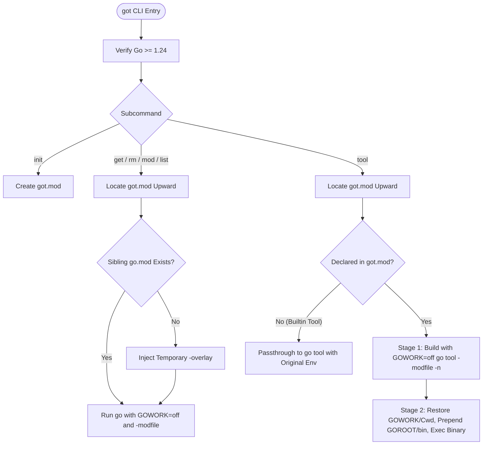

# got

[简体中文](README.md) | English

**`got`** is a standalone Go 1.24+ development tool dependency manager and runner. It isolates development tools (such as `golangci-lint`, `stringer`, `mockgen`, and `sqlc`) into dedicated `got.mod` and `got.sum` files—fully reusing Go's native `tool` ecosystem and caches while keeping your main `go.mod` and `go.sum` completely untouched.

---

## Why `got`?

Go 1.24 introduced the `tool` directive in `go.mod` along with `go get -tool` and `go tool`. However, declaring development tools directly inside a project's main `go.mod` introduces three common issues:

1. **Dependency bloat**: A single dev tool can pull dozens or hundreds of indirect dependencies into your application's `go.mod` and `go.sum`.
2. **MVS version coupling**: When a tool and your application share third-party dependencies, Go's Minimal Version Selection (MVS) may silently bump runtime package versions due to tool requirements.
3. **Cross-interference during upgrades**: Running `go get -u` for application code can inadvertently change tool versions (and vice versa), increasing review and regression overhead.

`got` solves these problems by managing tools in root-level `got.mod` / `got.sum` files while preserving the familiar Go CLI experience.

---

## Features

- **Complete isolation**: Tool declarations, indirect dependencies, and checksums live exclusively in `got.mod` / `got.sum`; the main `go.mod` / `go.sum` are never modified.
- **Native Go CLI ergonomics**: Familiar commands (`got init`, `got get -tool`, `got tool`, `got rm`, `got mod`, `got list`) with zero learning curve.
- **Native ecosystem reuse**: 100% reuses Go's build cache (`GOCACHE`), module cache (`GOMODCACHE`), checksum database (`GOSUMDB`), and MVS resolution.
- **Workspace (`go.work`) friendly**: Uses a two-stage build-and-exec engine so tools compile cleanly even inside `go.work` repositories while executing with your original `GOWORK` and environment intact.
- **Works without `go.mod`**: Automatically injects a temporary `-overlay` virtual `go.mod` in workspace roots or non-Go repositories and cleans it up on exit, leaving zero residual files.
- **Zero external dependencies**: Implemented purely with the Go standard library as a single static binary.

---

## Requirements & Installation

- **Go**: 1.24 or later.

### Install with `go install`

```bash
go install github.com/yougg/got/cmd/got@latest
```

### Build from source

```bash
git clone https://github.com/yougg/got.git
cd got
go install ./cmd/got
```

Verify installation:

```bash
got version
```

---

## Quick Start

Initialize `got.mod` in your repository root and manage development tools:

```bash
# 1. Initialize got.mod (default module path: got.local/tools)
got init

# 2. Add dev tools (writes to got.mod / got.sum without touching go.mod)
got get -tool golang.org/x/tools/cmd/stringer@latest
got get -tool github.com/golangci/golangci-lint/v2/cmd/golangci-lint@v2.0.0

# 3. Inspect declared tools
got list tool
got tool

# 4. Run tools (by short name or full import path)
got tool golangci-lint run ./...
got tool stringer -type=Status

# 5. Upgrade all tools declared in got.mod
got get -u

# 6. Remove a tool and tidy unused dependencies
got rm stringer
```

---

## Command Reference

```text
got [-C <dir>] <command> [arguments]
```

### Global Flags & Environment Variables

| Flag / Env Var | Description |
| :--- | :--- |
| `-C <dir>` | Change working directory before executing the command (supports both `got -C <dir> <cmd>` and `got <cmd> -C <dir>`). |
| `GOTFILE=<path>` | Explicitly specify the path to `got.mod`, bypassing upward directory lookup (relative or absolute). |
| `GOT_DEBUG=1` | Enable debug logging via `log/slog` to `stderr`, printing underlying `go` commands, env overrides, and `-overlay` status. |

### Subcommands

| Command | Examples | Behavior |
| :--- | :--- | :--- |
| **`got init`** | `got init [module-path]`<br>`got init --same-module` | Creates a new `got.mod`. Defaults to `got.local/tools`; `--same-module` copies the module path from a sibling `go.mod`. If a sibling `go.mod` already declares `tool` entries, `got init` automatically copies them into `got.mod` and fetches their pinned dependency versions (auto-adopting the main module path when local repository tools are present). |
| **`got get`** | `got get -tool pkg@v1.2.3`<br>`got get --init -tool pkg@latest`<br>`got get -u` | Delegates to `go get -modfile=<got.mod>`. `--init` auto-initializes `got.mod` if missing; `got get -u` with no package arguments automatically appends the `tool` meta-pattern. |
| **`got rm`**<br>(alias `remove`) | `got rm stringer`<br>`got rm example.com/a/cmd/gen` | Accepts short names or full import paths. Runs `go get -tool <pkg>@none` followed by `go mod tidy` to remove tools and prune dependencies in one step. |
| **`got tool`**<br>(alias `exe`) | `got tool`<br>`got tool [-n] <name> [args...]`<br>`got exe <name> [args...]` | Lists tools when called with no arguments; runs tools declared in `got.mod` via the two-stage build-and-exec engine (`-n` prints the cached binary path); passes undeclared names through to native `go tool`. |
| **`got mod`** | `got mod tidy`<br>`got mod download`<br>`got mod verify`<br>`got mod edit ...` | Injects `-modfile=<got.mod>` (and `-overlay` when needed) after the `mod` subcommand. When no local repository tools are declared, `got mod tidy` runs in an isolated temporary sandbox and writes results back so main project Go sources are never scanned. |
| **`got list`** | `got list tool`<br>`got list -m all` | Maps to `go list -modfile=<got.mod> ...`. |
| **`got version`** | `got version` | Prints the `got` version, build metadata, and underlying Go toolchain version. |
| **`got help`** | `got help` | Displays CLI usage information. |

---

## Common Workflows

### 1. Using with `//go:generate` in Subpackages

Declare generators directly inside any subpackage:

```go
//go:generate got tool stringer -type=MyEnum
```

When running `go generate ./...` from the repository root, `got` walks upward to locate the root `got.mod` for compilation while **preserving the subpackage's original working directory (`Cwd`)** during execution so generated files land in the right package.

### 2. Multi-Module Workspaces (`go.work`)

Native `go tool -modfile=...` fails inside `go.work` repositories with `-modfile cannot be used in workspace mode`. `got` avoids this via two-stage decoupling:

1. **Stage 1 (Build & Resolve)**: Runs `go tool -modfile=<got.mod> -n <pkg>` with `GOWORK=off` to trigger incremental compilation into `GOCACHE` and retrieve the executable path.
2. **Stage 2 (Execute)**: Restores your **original `GOWORK`, original environment, and original `Cwd`**, prepends `$GOROOT/bin` to `PATH`, executes the binary directly, forwards `SIGINT` / `SIGTERM`, and silently propagates the exact exit code.

Tools like `golangci-lint`, `mockgen`, and `wire` therefore retain full workspace awareness.

### 3. Repository-Local Tools (`--same-module`)

To track and run tools defined within your own repository (e.g., `./cmd/codegen`):

```bash
got init --same-module
got mod edit -tool example.com/myrepo/cmd/codegen
got mod tidy
got tool codegen
```

### 4. Repositories Without `go.mod`

In directories without a `go.mod` (such as a `go.work`-only root or a non-Go repository):

```bash
got get --init -tool example.com/mytool@latest
got tool mytool
```

`got` automatically creates a temporary empty `go.mod` mapping via `-overlay` and removes the temporary directory before exiting, leaving your repository clean.

### 5. Builtin Passthrough, Ambiguity Detection & `GOFLAGS` Isolation

- **Builtin Go tools**: Builtin SDK tools like `got tool vet ./...` or `got tool pprof` pass straight through to `go tool` with your original environment—even when no `got.mod` exists.
- **Ambiguity protection**: If multiple declared tools share the same short name, `got tool <shortName>` fails with a clear error listing all conflicting full import paths.
- **`GOFLAGS` sanitization**: Flags like `GOFLAGS="-mod=vendor"` or `"-mod=readonly"` are stripped during Stage 1 builds so tools resolve cleanly from the module cache, while the original `GOFLAGS` are preserved when executing the tool binary in Stage 2.
- **Cross-compilation `GOOS` / `GOARCH` safety**: When `GOOS` / `GOARCH` target a non-host platform, Stage 1 forces `GOHOSTOS` / `GOHOSTARCH` so tool binaries compile natively for the host (preventing `exec format error`), while Stage 2 preserves your original `GOOS` / `GOARCH` for the tool process.

---

## How It Works



See [DESIGN.md](DESIGN.md) for detailed architecture notes and design rationale.

---

## Development & Testing

All unit and end-to-end integration tests use only the Go standard library and an offline local `file://` module proxy (no network access required and no host `GOMODCACHE` pollution):

```bash
# Run all unit and end-to-end tests with race detection
go test -v -race -count=1 ./...

# Run static analysis
go vet ./...
```
