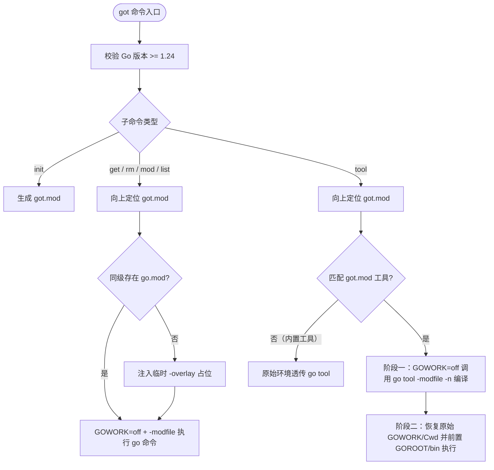

# got

简体中文 | [English](README.en.md)

**`got`** 是一个面向 Go 1.24+ 的独立开发工具链依赖管理与执行器。它将项目开发期工具（如 `golangci-lint`、`stringer`、`mockgen`、`sqlc` 等）隔离记录在独立的 `got.mod` 与 `got.sum` 中，在完全复用 Go 原生 `tool` 生态与构建缓存的同时，彻底避免污染主项目的 `go.mod` 与 `go.sum`。

---

## 为什么需要 `got`？

自 Go 1.24 起，官方引入了 `go.mod` 的 `tool` 指令与 `go get -tool` / `go tool` 命令。但直接把开发工具写入主项目 `go.mod` 会带来三个常见工程痛点：

1. **依赖图膨胀**：单个开发工具往往引入数十至上百个间接依赖，与业务运行时依赖混杂在主项目 `go.mod` / `go.sum` 中。
2. **MVS 版本耦合**：工具与业务代码依赖了同一三方库时，Go 的最小版本选择（MVS）机制可能会因工具依赖而被动拉高业务包版本。
3. **升级互相干扰**：升级业务依赖（`go get -u`）或升级工具依赖时容易互相牵连，增加代码评审与回归验证成本。

`got` 通过独立的根目录 `got.mod` / `got.sum` 解决上述问题，并提供与原生 `go` 命令高度一致的交互体验。

---

## 核心特性

- **完全隔离**：工具声明、间接依赖与校验和仅保存在 `got.mod` / `got.sum`，主项目 `go.mod` / `go.sum` 零修改。
- **原生对齐**：提供 `got init`、`got get -tool`、`got tool`、`got rm`、`got mod`、`got list` 等命令，与原生 Go CLI 习惯一致。
- **复用生态**：100% 复用 Go 原生构建缓存（`GOCACHE`）、模块缓存（`GOMODCACHE`）、校验和数据库（`GOSUMDB`）与 MVS 解析能力。
- **工作区兼容**：采用“两阶段编译与执行解耦”引擎，兼容 `go.work` 多模块工作区，同时保证被执行工具继承用户原始的 `GOWORK` 与环境变量。
- **无 `go.mod` 目录支持**：在纯 `go.work` 根目录或非 Go 项目仓库中自动注入临时 `-overlay` 虚拟占位并在退出前自动清理，不产生残留文件。
- **轻量零依赖**：仅使用 Go 标准库实现，编译为单一静态二进制。

---

## 环境要求与安装

- **Go 版本要求**：Go 1.24 及以上。

### 下载预编译二进制安装

前往 [GitHub Releases](https://github.com/yougg/got/releases) 下载对应平台（`linux/amd64`、`linux/arm64`、`darwin/arm64`、`windows/amd64`）的预编译压缩包，解压后将 `got`（Windows 为 `got.exe`）放入 `PATH` 目录即可：

```bash
# 以 Linux amd64 为例（将版本号替换为实际发布版本）
tar -xzf got_<version>_linux_amd64.tar.gz
install -m 0755 got_<version>_linux_amd64/got /usr/local/bin/got
```

> 可配合发布页附带的 `checksums.txt`（`sha256sum -c checksums.txt`）校验文件完整性。

### 使用 `go install` 安装

```bash
go install github.com/yougg/got@latest
```

### 从源码编译安装

```bash
git clone https://github.com/yougg/got.git
cd got
go install .
```

验证安装：

```bash
got version
```

---

## 快速开始

在项目根目录初始化 `got.mod` 并添加、运行、升级和移除工具：

```bash
# 1. 初始化 got.mod（同级存在 go.mod 时默认复用原模块名，否则使用 got.local/tools）
got init

# 2. 添加开发工具（写入 got.mod / got.sum，不修改 go.mod）
got get -tool golang.org/x/tools/cmd/stringer@latest
got get -tool github.com/golangci/golangci-lint/v2/cmd/golangci-lint@v2.0.0

# 3. 查看已声明的工具
got list tool
got tool

# 4. 运行工具（支持短名或完整包路径）
got tool golangci-lint run ./...
got exe stringer -type=Status

# 5. 更新 got.mod 中声明的所有工具
got get -u

# 6. 移除工具并自动 tidy 清理无用间接依赖
got rm stringer
```

---

## 命令参考

```text
got [-C <dir>] <command> [arguments]
```

### 全局参数与环境变量

| 选项 / 环境变量 | 说明 |
| :--- | :--- |
| `-C <dir>` | 在执行命令前切换工作目录（兼容 `got -C <dir> <cmd>` 与 `got <cmd> -C <dir>`）。 |
| `GOTFILE=<path>` | 显式指定 `got.mod` 路径，跳过向上目录查找（支持相对或绝对路径）。 |
| `GOT_DEBUG=1` | 开启调试日志，通过 `log/slog` 向 `stderr` 输出底层 `go` 命令、环境变量与 `-overlay` 状态。 |

### 子命令一览

| 命令 | 示例 | 说明 |
| :--- | :--- | :--- |
| **`got init`** | `got init [module-path]` | 初始化 `got.mod`。指定 `module-path` 时使用指定值；未指定时默认复用同级 `go.mod` 的模块路径，当前无 `go.mod` 时使用默认值 `got.local/tools`。若同级 `go.mod` 中已存在 `tool` 列表，会自动复制到 `got.mod` 并按对应版本及关联 `replace` 拉取依赖包完成初始化。 |
| **`got get`** | `got get -tool pkg@v1.2.3`<br>`got get -u` | 透传至 `go get -modfile=<got.mod>`。未找到 `got.mod` 时默认先自动初始化；使用 `got get -u` 且未传包参数时自动追加 `tool` 元包模式。 |
| **`got rm`**<br>（别名 `remove`） | `got rm stringer`<br>`got rm example.com/a/cmd/gen` | 支持短名或完整包路径，依次执行 `go get -tool <pkg>@none` 与 `go mod tidy`，一步移除工具并清理依赖。 |
| **`got tool`**<br>（别名 `exe`） | `got tool`<br>`got tool [-n] <name> [args...]`<br>`got exe <name> [args...]` | 无参数时列出可用工具；匹配 `got.mod` 时走两阶段编译与执行引擎（带 `-n` 仅打印缓存二进制路径）；未匹配时按 Go 内置工具原样透传 `go tool`。 |
| **`got mod`** | `got mod tidy`<br>`got mod download`<br>`got mod verify`<br>`got mod edit ...` | 在子命令之后自动注入 `-modfile=<got.mod>`（及必要的 `-overlay`），执行对应 `go mod` 子命令。执行 `got mod tidy`（不含仓库本地工具时）会在独立临时沙箱中运行并回写，避免扫描主项目业务源码。 |
| **`got list`** | `got list tool`<br>`got list -m all` | 映射为 `go list -modfile=<got.mod> ...`。 |
| **`got version`** | `got version` | 打印 `got` 版本、构建信息及底层 Go 工具链版本。 |
| **`got help`** | `got help` | 输出命令行使用说明。 |

---

## 典型使用场景

### 1. 配合 `//go:generate` 在子包目录运行

在业务子包代码中直接声明：

```go
//go:generate got tool stringer -type=MyEnum
```

在仓库根目录执行 `go generate ./...` 时，`got` 会自动向上定位根目录的 `got.mod` 完成编译，并在**保持子包原始工作目录（`Cwd`）不变**的前提下运行工具，确保生成文件准确写入子包目录。

### 2. `go.work` 多模块工作区

当仓库存在 `go.work` 时，原生 `go tool -modfile=...` 会因 workspace 模式冲突而报错。`got` 通过两阶段解耦解决该问题：

1. **阶段一（编译解析）**：在 `GOWORK=off` 隔离环境下调用 `go tool -modfile=<got.mod> -n <pkg>` 触发按需增量编译并获取 `GOCACHE` 中的可执行文件路径。
2. **阶段二（独立执行）**：恢复用户**原始 `GOWORK`、原始环境变量与原始工作目录**，并将 `$GOROOT/bin` 前置到 `PATH` 后直接执行二进制文件，同时转发 `SIGINT` / `SIGTERM` 信号并静默透传退出码。

因此 `golangci-lint`、`mockgen`、`wire` 等静态分析/代码生成工具可以完整读取多模块工作区上下文。

### 3. 管理仓库内部本地工具

如果项目自身包含内部工具包（例如 `./cmd/codegen`），直接 `got init` 即可默认复用同级 `go.mod` 的模块路径：

```bash
got init
got mod edit -tool example.com/myrepo/cmd/codegen
got mod tidy
got tool codegen
```

### 4. 无 `go.mod` 的纯目录或非 Go 仓库

在没有 `go.mod` 的目录（如纯 `go.work` 根目录或文档/基础设施仓库）中可以直接使用：

```bash
got get -tool example.com/mytool@latest
got exe mytool
```

`got` 会自动在系统临时目录生成虚拟 `go.mod` 占位并通过 `-overlay` 传递给底层 `go` 命令，执行结束后立即销毁，不在项目目录留下任何多余文件。

### 5. 内置工具透传、短名歧义与 `GOFLAGS` 隔离

- **Go 内置工具透传**：执行 `got tool vet ./...`、`got tool pprof` 等 Go SDK 内置工具时（无论是否存在 `got.mod`），均保留原始环境直接透传给 `go tool`。
- **同名工具歧义保护**：若 `got.mod` 中存在多个末段短名相同的工具路径，`got tool <shortName>` 会报错并列出全部冲突路径，提示使用完整包路径调用。
- **`GOFLAGS` 冲突隔离**：当环境中存在 `GOFLAGS="-mod=vendor"` 或 `"-mod=readonly"` 时，阶段一会自动剥离 `-mod` 标志以确保工具可正常构建，阶段二仍向工具子进程保留原始 `GOFLAGS`。
- **交叉编译 `GOOS` / `GOARCH` 保护**：在交叉编译场景下设置了非宿主机的 `GOOS` / `GOARCH` 时，阶段一会自动锁定为宿主机 `GOHOSTOS` / `GOHOSTARCH` 编译工具二进制（避免 `exec format error`），阶段二执行工具时仍完整保留用户原始 `GOOS` / `GOARCH`。

---

## 工作原理



更多架构与设计细节请参阅 [DESIGN.md](DESIGN.md)。

---

## 开发与测试

项目采用纯 Go 标准库实现，集成测试通过本地 `file://` 模拟模块代理离线运行，不依赖外网也不污染宿主机 `GOMODCACHE`：

```bash
# 运行全部单元测试与端到端集成测试（含竞态检测）
go test -v -race -count=1 ./...

# 静态检查
go vet ./...
```
